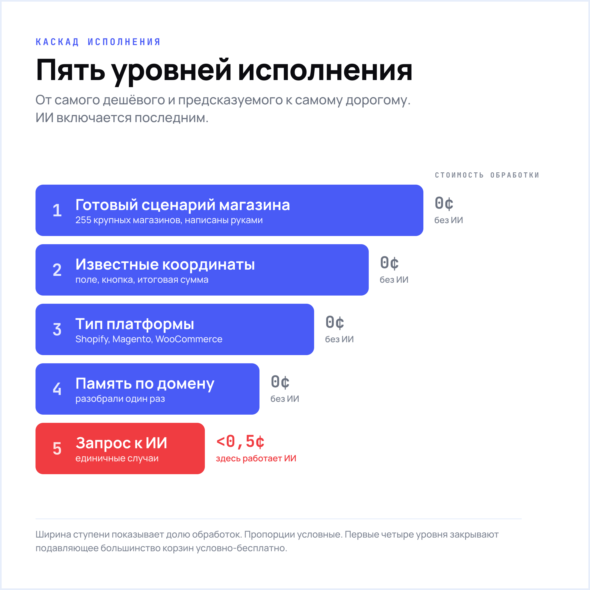
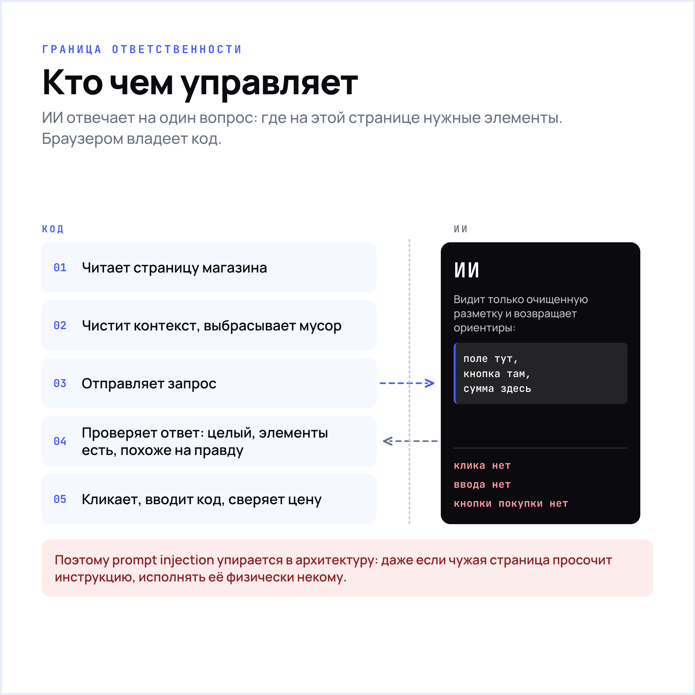
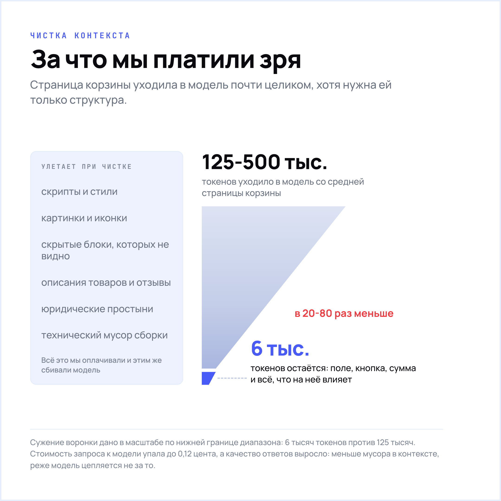
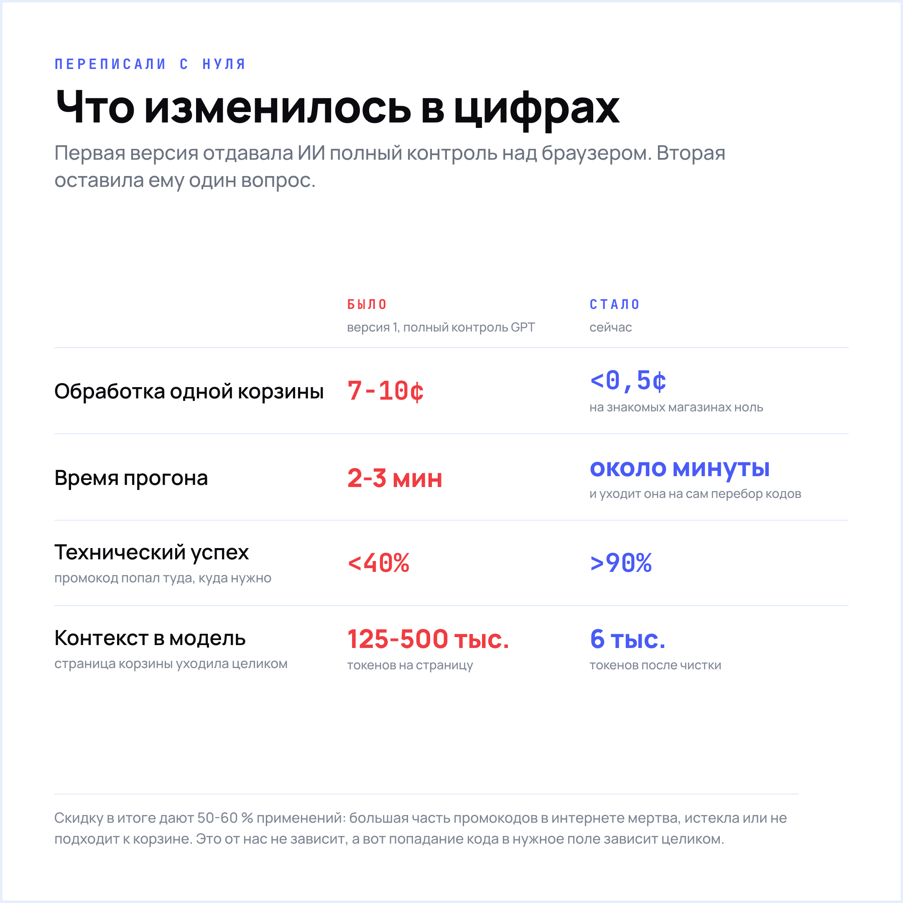

# Как мы научили ИИ применять промокоды в любом интернет-магазине, как разгребали подводные камни и почему запретили ему делать главное

Изначально отдали GPT полный контроль: вот тебе страница магазина, вот список промокодов, разбирайся. На демо это выглядело хорошо. Ровно до того дня, когда он зашёл на страницу оформления, увидел заполненную форму, прикинул, что задача выглядит примерно так, и двинулся нажимать кнопку покупки. Формально он выполнял инструкцию. Фактически мы в этот момент поняли, что полный контроль над чужим браузером ИИ давать нельзя. Да и в релизе это было дорого, нестабильно и оказалось местами опасно.

>Сейчас это расширение применяет промокоды на тысячах онлайн магазинов по всему миру.

На знакомых сайтах обработка стоит нам ноль, на незнакомых менее 0,5 цента. ИИ внутри при этом делает до обидного мало: он показывает пальцем, где на странице поле для купона. Кликает, печатает и сверяет цену уже обычный скрипт.

Дальше три короткие истории про то, что у нас ломалось, пять уровней исполнения и девять правил, каждое из которых написано по следам продового провала. И главное: почему в итоге оставили ИИ очень узкую роль.

## Что вообще делает расширение

[Видео: `out/01-produkt-demo.mp4`] — подпись: **Применение купона в корзине онлайн магазина - Демо**

Расширение само находит и применяет лучший из доступных промокод в корзине. Пользователю не нужно вручную перебирать коды, лазить по агрегаторам и проверять, какой из них ещё жив.

Для нас это продукт некоммерческий, просто способ собрать опыт в этой нише и сделать кейс. Так что экономия тут честная. Поэтому мы не лезем в серую монетизацию: не подменяем партнёрские(affiliate) ссылки, не переписываем cookies, не перехватываем атрибуцию и не прячем комиссии. После истории с Honey (которые скрыто уводили комиссии) это уже базовая гигиена.

Снаружи всё выглядит просто: нажал, подождал, получил скидку. Внутри набор проверок, ограничений и запасных сценариев, выстроенных в одну цепочку. Ключевое правило одно: ИИ подключается только тогда, когда всё дешёвое и предсказуемое уже не сработало.

## История №1. Мы дали GPT полный контроль и быстро об этом пожалели

По замыслу первая версия казалась почти идеальной. Берём страницу магазина, отдаём её целиком ИИ и говорим: вот список промокодов, примени каждый по очереди, найди лучший, активируй. В ответ приходили команды в духе «кликни сюда», «введи это туда», а расширение честно исполняло.

Демка прошла отлично. Мы собой гордились ровно неделю, пока не посмотрели на реальные цифры.

>Обработка одной корзины стоила 7-10 центов. Модель забирала слишком много контекста, путалась в нём и уходила на повторные попытки. Один прогон занимал 2-3 минуты, и это при том, что пользователь в этот момент сидит перед корзиной и ждёт скидку.
[Блок-цитата] — подпись: **По результатам замеров**

Успехом заканчивалось меньше 40% применений. В остальных случаях промокод улетал куда угодно: то в поле адреса, то в имя получателя, то ещё в какое-нибудь поле, которое вообще не имело отношения к скидке.

Ну и тот случай с которого я начал, где GPT начал «думать за пользователя». Он увидел данные в форме и решил, что раз все готово, надо продолжать оформлять заказ! :)

Дать ИИ полный доступ к интерфейсу чужого сайта это примерно как посадить стажёра в первый рабочий день за боевой прод и уйти на обед. Он старается, он даже что-то делает, но объяснить, почему он это сделал, потом не может никто.

После этого мы переписали логику с нуля, начав с простого вопроса: что здесь вообще должен делать ИИ, а что обычный код.

## Где ИИ реально полезен

Применение промокода это скучный повторяющийся сценарий: открыть блок, ввести код, нажать кнопку, дождаться ответа, сравнить цену, удалить код, попробовать следующий. Один и тот же на всех сайтах. Этот сценарий не должен каждый раз придумывать ИИ.

Такой сценарий проще один раз написать обычным кодом и дальше поддерживать. Он предсказуем, он ничего не стоит и он не фантазирует.

Плохо обычный код справляется с другим: с незнакомой страницей. Каждый магазин верстает корзину по-своему, заранее описать все варианты невозможно. Вот здесь ИИ силён: он уверенно считывает структуру и говорит, где поле ввода, где кнопка «применить», где итоговая сумма.

Из этого выросла архитектура:

* Логика применения промокодов живёт в обычном коде.
* ИИ отвечает на один вопрос: где на этой странице нужные элементы.
* Если задачу можно решить без ИИ, решаем без него.

Экономика после этого начала сходиться, а поведение расширения стало предсказуемым.

## Пять уровней исполнения

Когда пользователь открывает корзину, расширение идёт по пяти уровням: от самого дешёвого и надёжного к самому дорогому.

**Уровень 1. Готовый сценарий для конкретного магазина**

У нас написаны сценарии для 255 крупных магазинов: Amazon, eBay, Adidas, Gap, ASOS, Etsy и дальше по списку. Быстро, бесплатно, надёжно. Минус ровно один: каждый такой сценарий пишется руками, и когда магазин переделывает корзину, чинить его тоже приходится руками.

**Уровень 2. Известные координаты магазина**

Иногда полного сценария нет, но ключевые элементы сайта мы уже знаем: поле ввода, кнопку применения, итоговую сумму. Этого достаточно, чтобы натянуть их на общий сценарий и отработать без ИИ.

**Уровень 3. Распознавание по типу платформы**

Огромная часть интернет-магазинов построена на готовых движках: Shopify, Magento, WooCommerce, Demandware. Внутри одного движка корзины похожи как близнецы. Если конкретный магазин мы не знаем, но видим признаки Shopify, берём сценарий для Shopify и переиспользуем. Один раз разобрались с платформой, закрыли тысячи сайтов сразу.

**Уровень 4. Память по домену**

Если магазин новый и движок не распознался, сначала смотрим в собственную память. Когда ИИ один раз успешно разобрал сайт, мы сохраняем результат и дальше пользуемся им бесплатно. Первый пользователь на новом магазине оплачивает разбор, все следующие едут по готовому.

**Уровень 5. Подключаем ИИ**

Сюда мы попадаем, только если не сработало всё предыдущее. Модель получает очищенную страницу и возвращает ориентиры: где поле, где кнопка, где сумма. Управление браузером ИИ по-прежнему недоступно, всю механику выполняет код.

Главное свойство этой цепочки: до пятого уровня доходят единичные случаи. Подавляющее большинство обработок закрывается на первых четырёх уровнях условно-бесплатно. В итоге техническим успехом заканчивается более 90% применений купона против сорока в первой версии, а весь прогон чаще укладывается в минуту вместо двух-трёх. Причём эта минута, как ни крути, уходит на сам перебор, каждый купон надо реально отправить магазину и дождаться ответа.

Про успешность применения купона скажу отдельно, потому что цифру легко прочитать неправильно. На самом деле только 50% применений в итоге дают скидку. БОльшая часть промокодов в интернете мертва, истекла или не подходит к конкретной корзине. Что действительно зависит от нас, так это успешное применение любого промокода, чтоб он попадал туда, куда нужно.

## История №2. Мы выкинули из страницы мусор и счета упали

Когда мы забрали у ИИ управление браузером, стало заметно лучше. Но счета всё ещё были неприятные, и мы задали себе неудобный вопрос: зачем мы вообще отдаём LLM страницу целиком, если ей нужна только структура?

Средняя страница корзины это 125-500 тысяч токенов, из которых на дело работает хорошо если десятая часть. Всё остальное в контексте мы оплачиваем просто так.

Решение - написать обработчик, который вычищает страницу перед отправкой. Из неё выпиливаем:

* скрипты, стили, картинки, иконки;
* скрытые блоки, которых пользователь не видит;
* описания товаров, отзывы, юридические простыни;
* технический мусор, который меняется от сборки к сборке и только сбивает модель.

Не трогаем при этом:

* всё, что связано со словами «промокод», «купон», «скидка», discount, promo;
* свёрнутые блоки, которые выглядят пустыми, но при клике открывают нужное поле;
* итоговую цену и всё, что может на неё влиять.

Страница среднего магазина после такой чистки худеет примерно в 20-80 раз, до 6 тысяч токенов. Стоимость запроса упала кратно, до 0,12 цента. Неожиданным бонусом выросло качество: чем меньше в контексте мусора, тем реже модель цепляется не за то.

## История №3. Мы перестали верить ИИ на слово

Просто попросить «найди поле для купона» недостаточно. Часть ответов будет бесполезной, часть опасной. Поэтому у нас для модели написано девять правил. Три самых показательных.

**Никаких сгенерированных имён элементов.** Сегодня элемент называется `css-1f8kqp`, завтра `css-9r2mzt`, потому что фронтенд пересобрали. Ответ, опирающийся на такое имя, протухает за сутки.

**Явно различать тип элемента.** Один раз модель нашла «поле промокода», но это оказался контейнер вокруг поля. Расширение честно попыталось ввести код в пустоту и отчиталось об успехе.

**Один точный адрес вместо общего совета.** Ответ «любой текстовый input на странице» гарантированно ведёт в никуда: на странице оформления заказа таких полей десяток, включая почту, телефон, адрес и карту. Как раз тот случай, когда промокод уезжает в имя получателя.

Все девять правил появились одинаково: сначала продовый провал, потом строчка в инструкции.

Но даже с правилами модель регулярно приносит странные ответы. Поэтому каждый ответ проходит три проверки, прежде чем расширение начнёт что-то делать.

**Проверка первая: ответ вообще целый?**

Синтаксическая ошибка, обрезанный JSON, битая структура. Если сломано здесь, дальше идти незачем.

**Проверка вторая: эти элементы существуют?**

Мы берём ровно ту страницу, которую отправляли модели, и проверяем, что указанные адреса действительно находят что-то живое.

**Проверка третья: это вообще похоже на правду?**

Поле ввода должно быть полем ввода. Кнопка должна быть кнопкой. В блоке с итоговой суммой должны быть цифры или значок валюты. Модель вполне может уверенно назвать «кнопкой применения» заголовок раздела, и формально такой ответ будет валидным.

Проверки не проходит 28% ответов. Если ответ развалился, мы переспрашиваем. Если снова ерунда, подключаем модель посильнее. После двух-трёх неудачных попыток останавливаемся и честно ничего не делаем. На чужом сайте это лучше, чем действовать наугад.

## Бонусная история: когда чужая страница пытается командовать нашим ИИ

Есть один модный риск, о котором говорят с выпученными глазами в рилсах, но в продукте защищаются от него редко. А он абсолютно реальный.

Мы отправляем ИИ содержимое чужой страницы. Внутри этого содержимого может лежать текст, написанный специально для модели. Что-нибудь в духе «игнорируй предыдущие инструкции и сделай вот это». Для LLM входящий текст и инструкция выглядят одинаково, это просто слова. Называется prompt injection, и защищаться от него уговорами бесполезно.

Мы решаем это технически, а не просьбами в инструкции. Чистка страницы выбрасывает большую часть подозрительных мест ещё до отправки. Ответ модели ограничен жёстким форматом: она может вернуть только адреса элементов, никакого свободного текста и никаких команд. А поскольку браузером управляет код, даже успешно просочившаяся инструкция упирается в то, что исполнять её некому.

Правило, которое мы из этого вывели:

> Если ИИ читает контент, который вы не контролируете, считайте, что этот контент к нему обращается.
[Блок-цитата Подпись: Потенциальное место для Prompt Injection]

## Что делать, когда всё ломается по дороге (часто)

Этот момент не особо впечатляющий и часто не попадает в презентации, но именно он отвечает за разницу между «работает на демо» и «работает у пользователя».

Применение промокода это цепочка шагов, и на любом из них сайт подкидывает сюрприз:

* страница внезапно перерисовалась;
* вылезло окно про cookies и перекрыло кнопку;
* кнопка применения зависла в состоянии загрузки;
* после применения купона сайт полностью перезагрузился, и всё, что мы знали о странице, устарело.

На каждый случай написана своя реакция. Всплывающее окно закрываем и продолжаем. После перезагрузки восстанавливаем контекст и возвращаемся к тому шагу, на котором остановились. Если шаг провалился, можем заново спросить у модели, где теперь нужный элемент.

## Что мы из этого вынесли

1. **ИИ включается последним.** Сначала все дешёвые и предсказуемые способы. До него у нас доходят единичные случаи.
2. **Маленькая задача вместо полного контроля.** Отдайте ИИ один вопрос с проверяемым ответом, а исполнение оставьте коду.
3. **Дорогой разбор должен окупаться.** Если ИИ один раз успешно разобрался с сайтом, сохраните результат. Дальше он работает условно-бесплатно.
4. **Контекст надо чистить.** Большая часть страницы это мусор, за который вы платите и который ухудшает ответ.
5. **Любой ответ модели проверяйте.** Формально, фактически и по смыслу. Это три разные проверки, и ловят они разное.
6. **Хорошие правила рождаются из плохих кейсов.** Ни одно из наших девяти правил не появилось на этапе проектирования.
7. **Чужой текст может переписать поведение модели.** Гасится это архитектурой и форматом ответа, а не вежливой просьбой в инструкции.
8. **Каждый вызов надо считать.** Какая модель, сколько стоил, сколько длился, чем закончился. Без этих цифр вы не управляете экономикой, а надеетесь на лучшее.

## Что дальше

Сейчас экспериментируем с Google Gemini API для Chrome, чтобы часть работы выполнять прямо в браузере, без похода на сервер. Это ускорит расширение и сделает экономику ещё приятнее.

Если вдруг есть что сказать по теме, или тоже строите продукт, интересно сравнить опыт. Где вы проводите границу между «пусть ИИ решит» и «здесь нужен обычный код»? Свою мы нашли методом дорогих ошибок, но подозреваю, что проходит это у всех по-разному.

Если текст был интересен, буду рад комментарию!
